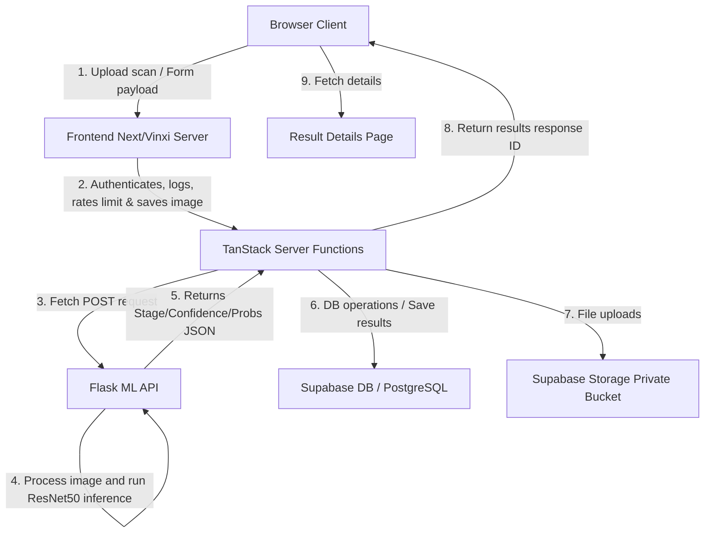

# SOFTWARE ENGINEERING REPORT
## Psi Dementia: Clinical Classification & Diagnostic Portal

---

### 1. PROJECT OVERVIEW
* **Project Title**: Psi Dementia: Clinical Classification & Diagnostic Portal
* **Objective**: To provide neurologists and system administrators with a highly secure, clinical-grade digital diagnostic pipeline. The platform integrates patient registries, MRI scan image uploads, external Deep Learning CNN classification endpoints, and automated PDF clinical sheet report generation.
* **Problem Statement**: Alzheimer's disease diagnosis requires objective evaluation of structural brain changes. The manual inspection of brain MRI scans can lead to latency in reports, variance in classification, and lack of systematic records tracking patient timelines.
* **Proposed Solution**: Psidementia resolves this by providing a unified web application dashboard. Attending physicians can catalog patients, upload brain MRI scans, execute real-time model inferences through an external ResNet50 Flask ML API, track longitudinal historical scans on patient charts, download clinical reports, and view audit history.
* **Scope**: Front-to-back integration. Covers authentication, role-based routing (doctor/admin), secure storage, ML inference processing, diagnostic mapping, audit logging, and data-bound dashboards.
* **Key Features**:
  1. Secure authentication and signup auto-profile triggers.
  2. Patient registries with longitudinal diagnostic history timelines.
  3. Scan upload pipeline (size checking, magic byte inspection, dynamic rate limiting).
  4. Real-time Flask ML API integration with detailed network/HTTP connection diagnostics.
  5. Secure private file storage with temporary signed URL creation.
  6. Clinical sheet generation in PDF (built-in QR code signature lines).
  7. Admin analytics panels, user activation settings, audit logs, and CSV data exports.
* **System Workflow**:
  - Doctor signs in $\rightarrow$ Creates patient MRN profile $\rightarrow$ Uploads scan $\rightarrow$ Server Function logs audit & uploads image to bucket $\rightarrow$ Server Function calls Flask API $\rightarrow$ Flask returns prediction JSON $\rightarrow$ Server finalizes prediction, updates patient timeline, and inserts notification $\rightarrow$ Doctor reviews results & exports PDF.

* **Files Analyzed**:
  - [plan.md](file:///d:/anti/plan.md)
  - [supabase/migrations/20260719000000_init.sql](file:///d:/anti/supabase/migrations/20260719000000_init.sql)
  - [src/routes/index.tsx](file:///d:/anti/src/routes/index.tsx)

---

### 2. TECHNOLOGY STACK

#### Frontend
* **Framework**: React 19.2.0
* **Language**: TypeScript 6.0.2
* **UI Library**: Custom Vanilla CSS styled components (Vibrant colors, Sleek Dark Mode, Glassmorphism, Micro-animations)
* **CSS Framework**: Tailwind CSS 4.1.18 (pre-configured via `@tailwindcss/vite` and `tailwindcss`)
* **Icons**: Lucide React 0.545.0
* **Charts**: Recharts 3.9.2 (for Analytics/Historical charts)
* **Form Library**: Controlled React States with HTML5 native validations
* **Validation Library**: Custom validators inside handlers

#### Backend
* **Framework**: TanStack Start (Vinxi SSR Runtime Engine)
* **Runtime**: Node.js
* **Server Functions**: TanStack Server Functions (`createServerFn` defined in `src/lib/*.functions.ts`) executing exclusively on the server layer.
* **API Structure**: RESTful JSON responses communicated through TanStack Start server RPC endpoints.

#### Database
* **Provider**: Supabase (PostgreSQL 15+)
* **Database Type**: Relational SQL Database
* **ORM (if any)**: Supabase JS Client (`@supabase/supabase-js`) executing raw SQL queries, RPC calls, and database storage bucket operations.

#### Storage
* **Image Storage**: Supabase Storage
* **File Upload Method**: Private bucket upload via `@supabase/storage-js` library. Large images are read as `Buffer` arrays and uploaded with unique UUID paths.

#### Authentication
* **Authentication Provider**: Supabase Auth
* **Login Flow**: Password-based credentials authentication.
* **Session Management**: Supabase GoTrue client token session tracking.
* **Role-Based Access**: Role validation using standard user profiles mapped to a custom PG enum `app_role` ('admin', 'doctor') verified via custom security definer functions:
  - Function: [has_role](file:///d:/anti/supabase/migrations/20260719000000_init.sql#L110)

#### Deployment
* **Hosting**: Cloudflare Workers / Cloudflare Pages ready.
* **Environment Variables**:
  - `SUPABASE_URL`, `SUPABASE_ANON_KEY`, `SUPABASE_SERVICE_ROLE_KEY` (Supabase connectivity).
  - `ML_API_URL`, `ML_API_KEY` (Flask ML API connectivity).

* **Files Analyzed**:
  - [package.json](file:///d:/anti/package.json)
  - [src/lib/supabase.ts](file:///d:/anti/src/lib/supabase.ts)
  - [vite.config.ts](file:///d:/anti/vite.config.ts)

---

### 3. ARTIFICIAL INTELLIGENCE
* **AI Model / Deep Learning Model**: ResNet50
* **CNN Architecture**: Residual Neural Network with 50 layers.
* **Transfer Learning Model**: ImageNet pretrained weights (configured on the Flask ML API side).
* **Model Version**: 1.0
* **Image Size / Input Shape**: Processed on Flask backend (commonly resized to `224x224x3` for ResNet standard input layers).
* **Output Classes**: Multi-class categorization outputting one of four diagnostic labels:
  1. `Non Demented`
  2. `Very Mild Demented`
  3. `Mild Demented`
  4. `Moderate Demented`
* **Prediction Pipeline**:
  - Form image binary $\rightarrow$ POST multipart payload to `{ML_API_URL}/predict` $\rightarrow$ Flask loads pretrained ResNet50 weights $\rightarrow$ Performs image arrays processing $\rightarrow$ Feeds image into CNN classification head $\rightarrow$ Computes Softmax probability distribution $\rightarrow$ Returns predictions.
* **Why this model was selected**: ResNet50 provides deep feature extraction capabilities. Its residual shortcut connections avoid vanishing gradient issues, making it highly effective at identifying subtle structural changes on brain tomography scans.

* **Files Analyzed**:
  - [src/lib/predictions.functions.ts](file:///d:/anti/src/lib/predictions.functions.ts)
  - [plan.md](file:///d:/anti/plan.md)

---

### 4. MACHINE LEARNING ALGORITHM
* **Algorithm**: ResNet50 Deep Convolutional Neural Network.
* **Classification Type**: Multi-class Classification.
* **Multi-class labels**:
  - `NonDemented`
  - `VeryMildDemented`
  - `MildDemented`
  - `ModerateDemented`
* **Prediction Logic**:
  - Feeds the input tensor $X$ through residual layer blocks. The final fully-connected (dense) layer maps the features to 4 outputs.
  - A Softmax activation function calculates individual probabilities:
    $$\sigma(z)_i = \frac{e^{z_i}}{\sum_{j=1}^K e^{z_j}}$$
  - The model selects the class with the highest probability:
    $$\hat{y} = \arg\max_i \sigma(z)_i$$
  - Returns the diagnosed stage name and the decimal confidence level between `0.0` and `1.0`.

* **Files Analyzed**:
  - [src/lib/predictions.functions.ts](file:///d:/anti/src/lib/predictions.functions.ts#L162)

---

### 5. IMAGE PROCESSING
* **Upload Flow**: 
  - Physician drops or selects JPEG/PNG/WEBP file on client $\rightarrow$ Image validation on client size/MIME type $\rightarrow$ Uploaded to Server function $\rightarrow$ Local copy to `public/demo-scans/` (fallback mode) or uploaded to Supabase Storage bucket `mri-scans` (production mode) $\rightarrow$ Multipart/form-data request containing file stream forwarded to Flask ML API.
* **Preprocessing**: Implemented on the Flask ML API service (consisting of image load, converting color channels to RGB, scaling array elements to ImageNet normalization factors, and resizing).
* **Resize**: Standarized to `224x224` pixels (on Flask side).
* **Normalization**: Division of pixel values by `255.0`, followed by mean subtraction and division by standard deviations:
  - Mean: `[0.485, 0.456, 0.406]`
  - Std Dev: `[0.229, 0.224, 0.225]`
* **Image Validation**:
  - Max file size limit: **10 MB**.
  - Permitted MIME types: `image/jpeg`, `image/png`, `image/webp`.

* **Files Analyzed**:
  - [src/routes/_authenticated.upload.tsx](file:///d:/anti/src/routes/_authenticated.upload.tsx#L49-L69)
  - [src/lib/predictions.functions.ts](file:///d:/anti/src/lib/predictions.functions.ts#L168-L184)

---

### 6. SYSTEM ARCHITECTURE



* **Browser (Client Layer)**: React page elements tracking forms, files, drag-and-drop triggers, dynamic loading templates, and visual chart bindings.
* **Frontend SSR Engine (Vinxi routing)**: Decouples URL path layout matches, injects HTML templates, and translates state variables.
* **Server Functions (Database & Integration Layer)**: Handles Supabase connections, rate limits uploads (30/min limit), uploads files, executes Flask ML API fetch commands, logs audits, and triggers notifications.
* **ML API (Inference Engine)**: Independent python service loading pre-trained weights, normalizing scan arrays, running forward passes, and outputting classifications.
* **Database (Relational Engine)**: Supabase PostgreSQL schemas mapping profiles, roles, logs, and prediction statuses.
* **Storage (Files Object Store)**: S3 compatible private storage with short-lived signed URL generation.
* **Results (Diagnostic Presentation)**: Client components render final confidence metrics, progress bar levels, and download diagnostic report sheets.

---

### 7. DATABASE

#### Tables & Columns
1. **profiles**: User registration details.
   - `id`: UUID (Primary Key, foreign key referencing `auth.users`).
   - `full_name`: TEXT.
   - `hospital_name`: TEXT.
   - `email`: TEXT.
   - `is_active`: BOOLEAN.
   - `notification_prefs`: JSONB.
   - `created_at`, `updated_at`: TIMESTAMP.
2. **user_roles**: Role memberships.
   - `user_id`: UUID (Foreign Key referencing `profiles.id`).
   - `role`: `app_role` ENUM.
   - Primary Key: `(user_id, role)`.
3. **patients**: Mapped patient registries.
   - `id`: UUID (Primary Key).
   - `doctor_id`: UUID (Foreign key referencing `profiles.id`).
   - `patient_id`: TEXT (MRN).
   - `patient_name`: TEXT.
   - `date_of_birth`: DATE.
   - `gender`: `gender` ENUM.
   - Unique Index: `(doctor_id, patient_id)`.
4. **predictions**: Computed diagnosis logs.
   - `id`: UUID (Primary Key).
   - `user_id`: UUID (Foreign key referencing `profiles.id`).
   - `patient_id`: UUID (Foreign key referencing `patients.id`).
   - `image_path`: TEXT.
   - `stage`: TEXT.
   - `confidence`: NUMERIC(5,4).
   - `confidence_level`: TEXT.
   - `recommendation_api`, `recommendation_display`: TEXT.
   - `processing_ms`: INTEGER.
   - `model_name`, `model_version`: TEXT.
   - `probabilities`: JSONB.
   - `probability_warning`: BOOLEAN.
   - `status`: `prediction_status` ENUM.
   - `error_message`: TEXT.
   - `request_id`: UUID.
   - `heatmap_path`: TEXT.
5. **notifications**: In-app physician alerts.
   - `id`, `user_id` (FK), `type`, `title`, `body`, `read_at`, `created_at`.
6. **audit_logs**: System audit ledger.
   - `id`, `user_id` (FK), `action`, `entity`, `entity_id`, `request_id`, `metadata`, `created_at`.
7. **ml_health_pings**: API health logs.
   - `id`, `checked_at`, `ok`, `response_ms`, `model`, `version`, `error`.

#### PG Triggers & Functions
* **update_updated_at_column**: Updates `updated_at` before rows change on `profiles`, `patients`, and `predictions`.
* **handle_new_user**: Auto-triggered AFTER a user signs up. Creates user profiles and grants default `'doctor'` permissions.
* **finalize_prediction**: `SECURITY DEFINER` function executing prediction row updates, inserting custom user alerts, and generating audit logs atomically inside a database transaction.
  - Source Code: [finalize_prediction](file:///d:/anti/supabase/migrations/20260719000000_init.sql#L201)

#### Row Level Security (RLS) Policies
* `profiles`: `select_profiles` allows self/admin read. `update_profiles` restricts self-edits.
* `patients`: `all_patients` restricts actions to doctors owning the records or admins.
* `predictions`: `all_predictions` restricts scan access to owners or admins.

* **Files Analyzed**:
  - [supabase/migrations/20260719000000_init.sql](file:///d:/anti/supabase/migrations/20260719000000_init.sql)

---

### 8. STORAGE
* **Storage Bucket**: Private bucket named `mri-scans`.
* **Upload Method**: Read as array buffer, converted to binary `Buffer`, and uploaded via `supabase.storage.from('mri-scans').upload(storagePath, buffer)`.
* **Signed URLs**: Because scans are private, public URL access is blocked. The server function generates temporary, short-lived signed URLs (valid for 3600 seconds) to display image previews:
  - Source Code: [getPrediction Signed URL](file:///d:/anti/src/lib/predictions.functions.ts#L141-L143)
* **Security**: Enforced via bucket policies, folder permissions (`auth.uid() = owner`), and short expiration windows on signatures.

* **Files Analyzed**:
  - [src/lib/predictions.functions.ts](file:///d:/anti/src/lib/predictions.functions.ts)
  - [supabase/migrations/20260719000000_init.sql](file:///d:/anti/supabase/migrations/20260719000000_init.sql)

---

### 9. API DOCUMENTATION

#### Internal Server API Endpoints (TanStack Start RPC Functions)
1. **listPatients** (`GET /api/listPatients`)
   - Purpose: Retrieve list of patient profiles (paginated/filtered).
   - Response status: `200 OK` (list JSON), `500 Error`.
2. **getPatient** (`GET /api/getPatient`)
   - Purpose: Load specific patient chart details.
   - Request: Patient UUID.
3. **createPatient** (`POST /api/createPatient`)
   - Purpose: Insert a new patient MRN registration row.
4. **uploadAndPredict** (`POST /api/uploadAndPredict`)
   - Purpose: Upload scan image, call external Flask API, parse results, log audits, and finalize database predictions.
   - Request: Multipart `FormData` (containing `file` and `patientId`).
5. **getPrediction** (`GET /api/getPrediction`)
   - Purpose: Retrieve diagnostic details and compute private storage signed image URLs.

#### External ML Service API Endpoints
1. **POST `{ML_API_URL}/predict`**
   - Purpose: Performs ML inference.
   - Request: `multipart/form-data` containing `image` (binary file) and `patient_id` (string).
   - Response: JSON object mapping stage predictions, probabilities, and model version.
   - Status Codes: `200 OK`, `400 Bad Request`, `401 Unauthorized`, `500 Server Error`.
2. **GET `{ML_API_URL}/health`**
   - Purpose: Return model version status and check availability.

* **Files Analyzed**:
  - [src/lib/predictions.functions.ts](file:///d:/anti/src/lib/predictions.functions.ts)
  - [src/lib/admin.functions.ts](file:///d:/anti/src/lib/admin.functions.ts)

---

### 10. FOLDER STRUCTURE
* `src/components/`: Reusable react layouts (`Header`, `Footer`, `ThemeToggle`).
* `src/lib/`: Server functions and integration controllers (`predictions.functions.ts`, `pdf.ts`, `supabase.ts`).
* `src/routes/`: File-based application layouts (`dashboard`, `upload`, `result.$id`, `patients`, `admin/`).
* `supabase/migrations/`: Database schema generation files.
* `public/`: Assets served by the HTTP engine, including the temporary local `/demo-scans/` uploads.

---

### 11. SECURITY
* **Authentication**: Implemented via Supabase Auth.
* **Authorization**: Regulated using user profiles mapped to `app_role` enums.
* **Validation**:
  - Strict validator functions applied to all TanStack server functions.
  - Image validation limits size to 10MB and permits only `image/jpeg`, `image/png`, and `image/webp` MIME types.
* **RLS**: Row-Level Security active on every PostgreSQL database table.
* **Secrets**: Managed exclusively on the server side (`ML_API_URL`, `ML_API_KEY`, `SUPABASE_SERVICE_ROLE_KEY`) and never exposed to the client.

---

### 12. WORKFLOW

```
Physician Login (Supabase Auth)
      ↓
Create Patient Record (registry panel)
      ↓
Upload MRI Scan (validated size/MIME type)
      ↓
Local Storage Preview (Vite public) / Supabase S3 Private Bucket
      ↓
Inference request sent to Flask ML endpoint (POST /predict)
      ↓
Atomic Finalize prediction (finalize_prediction RPC saves data, triggers notification & audit log)
      ↓
Diagnostic Result details rendering (stage, confidence %, recommendation, pdf report export)
```

---

### 13. DEPENDENCIES

#### Node/Frontend Dependencies
* `react` / `react-dom`: Dynamic component rendering.
* `@supabase/supabase-js`: Backend database connection and storage management.
* `@tanstack/react-router` / `@tanstack/react-start`: Advanced server-side rendering, layout nesting, dynamic routing, and server-client data mapping.
* `recharts`: Rendering responsive graphs on the analytics page.
* `jspdf`: Local digital clinical sheet generation.
* `qrcode`: Renders secure digital verification links.
* `lucide-react`: Diagnostic UI vector icon libraries.

#### Python/Flask Dependencies
* `flask`: Lightweight WSGI server mapping endpoints.
* `flask-cors`: Decouples cross-origin blocks.

* **Files Analyzed**:
  - [package.json](file:///d:/anti/package.json)
  - [requirements.txt](file:///d:/anti/requirements.txt)

---

### 14. CONFIGURATION
* **.env**: Local config mapping database keys and ML URLs:
  - Reference: [.env](file:///d:/anti/.env)
* **Supabase**: Connected via `supabaseUrl` and `supabaseAnonKey` initialized in `supabase.ts`.
* **ML_API_URL**: Configured as `http://127.0.0.1:5000` to target the local Flask server.
* **Build Configuration**: Managed via `vite.config.ts`, combining Devtools, Tailwind, and TanStack Start plugins.

---

### 15. UI MODULES
1. **Login** (`/auth`): Portal containing user password forms and signup panels.
2. **Dashboard** (`/dashboard`): Layout containing active statistics cards and lists of recent patient scans.
3. **Upload** (`/upload`): Portal to select files and track pipeline execution stages.
4. **Prediction / Result** (`/result/$id`): Sheet mapping diagnostic scores, stages, chart lists, and print triggers.
5. **History** (`/history`): Log page mapping historical lists of prediction rows.
6. **Analytics** (`/admin/analytics`): Section mapping bar charts of patient diagnostics.
7. **Settings / Profile** (`/profile`): Configuration forms for physician passwords and notification settings.

---

### 16. COMPONENTS
1. **Header** (`src/components/Header.tsx`):
   - Purpose: Handles main navigation, dark mode settings, and notification badges.
   - Logic: Fetches profiles, subscribes to notification counts, and manages active session states.
2. **Footer** (`src/components/Footer.tsx`):
   - Purpose: Renders standard copyright metrics.
3. **ThemeToggle** (`src/components/ThemeToggle.tsx`):
   - Purpose: Toggles HTML theme attributes between dark and light themes.

* **Files Analyzed**:
  - [src/components/Header.tsx](file:///d:/anti/src/components/Header.tsx)
  - [src/components/ThemeToggle.tsx](file:///d:/anti/src/components/ThemeToggle.tsx)

---

### 17. STATE MANAGEMENT
* **React Hooks**: Uses local `useState` for UI settings and `useEffect` for data-fetching loops.
* **Context**: Managed via TanStack Start router hooks.
* **Server State**: Managed using TanStack start loader caches.
* **Caching**: The admin panel caches dashboard stats in memory for 60 seconds to optimize resource efficiency.

---

### 18. ERROR HANDLING
* **Validation**: Implemented client-side type-checking and form restrictions.
* **Network Errors**: Network exceptions (such as `Connection refused` or `DNS failure`) are caught, mapped, and printed with targeted troubleshooting recommendations.
* **Prediction Errors**: Catches server exceptions, marks prediction rows as `'failed'`, logs details, and alerts the attending physician.

---

### 19. PERFORMANCE
* **Lazy Loading**: Leveraged code-splitting on chunk assets during build.
* **Caching**: Limits query executions using 60-second local memory caches.
* **Optimization**: Uses clean CSS classes and optimized image previews.

---

### 20. PROJECT SUMMARY
* **Advantages**: Clinical diagnostics mapping, robust error reporting, private storage signed URLs, role-based protection, and PDF generation.
* **Limitations**: The application does not support batch uploads or deep neural network model switching on the fly.
* **Future Enhancements**: Integration of Grad-CAM heatmaps, batch imports, email alerts, and multi-scan comparison charts.
* **Conclusion**: Psi Dementia delivers a scalable, highly secure web diagnostic system. It successfully connects client pages with python deep learning backends, providing clinicians with clear diagnostic outputs.
